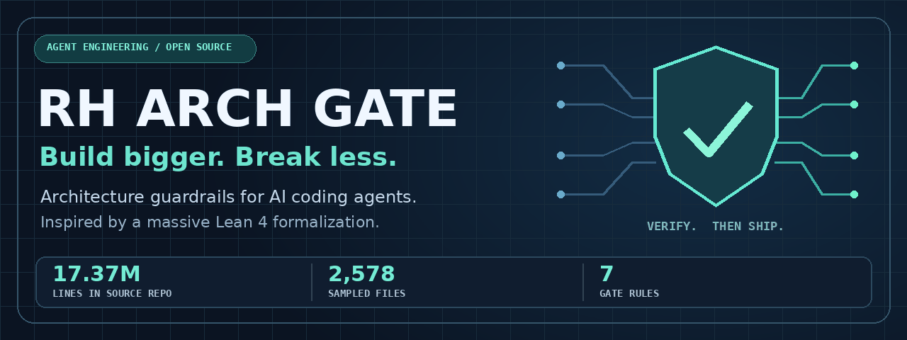
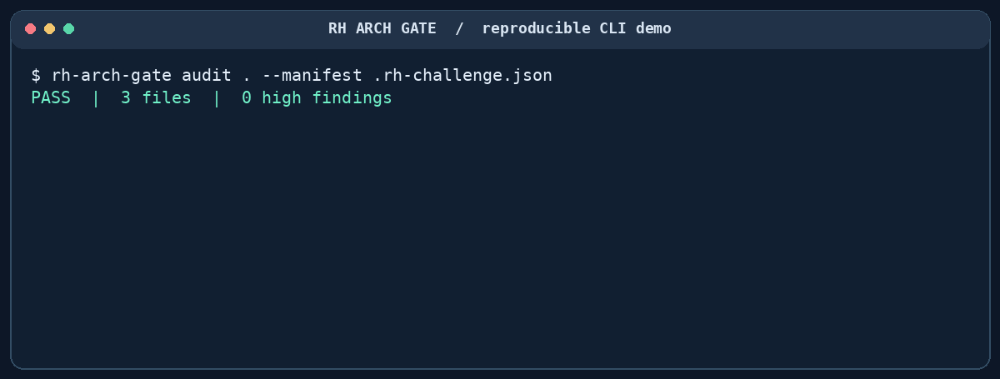
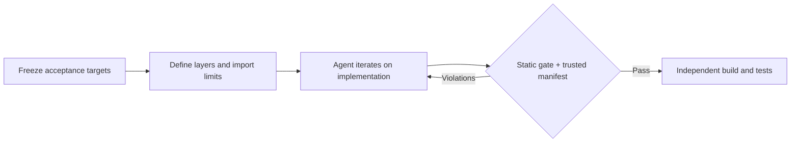

<p align="center">
  
</p>

# RH Arch Gate

**English** | [简体中文](README_ZH.md)

**Give your coding agent architectural guardrails it can actually check.** RH Arch Gate combines an [Agent Skill](SKILL.md) with a deterministic, zero-runtime-dependency CLI to flag architecture drift, dependency cycles, unfinished implementations and changes to frozen acceptance contracts.

[](https://github.com/WSlez13089/riemann-hypothesis-agent-skill/actions/workflows/ci.yml)
[](https://github.com/WSlez13089/riemann-hypothesis-agent-skill/releases)
[](#quick-start)
[](#quick-start)
[](LICENSE)

[Quick start](#quick-start) · [Live demo](#see-the-gate-in-action) · [Architecture](#how-it-works) · [Evidence](#where-the-rules-come-from) · [Limitations](#scope-and-limitations)

## See the gate in action



The animation summarizes **actual CLI results** from a tiny, deliberately constructed Python fixture. It is not a benchmark of agent performance. Reproduce it after cloning (Python 3.12+):

```bash
python examples/quick_demo.py
```

The script creates its own temporary directory, checks a clean baseline, introduces three violations, then restores the baseline. It exits with an error if the expected gate behavior is not observed. Your own workspace is not modified.

## Quick start

### Install the Agent Skill

```bash
npx skills add WSlez13089/riemann-hypothesis-agent-skill
```

For agents that support SKILL.md, follow their installation instructions. Alternatively, clone this repo into a compatible local skills directory. Read the [skill protocol](SKILL.md) before activating it. Installation alone does not enforce rules: the agent or CI must actually run the gate.

### Audit your own repository

```bash
uvx --from git+https://github.com/WSlez13089/riemann-hypothesis-agent-skill.git@v1.0.0 rh-arch-gate audit .
```

Or clone and run the CLI directly with Python 3.12+:

```bash
python scripts/rh_arch_gate.py audit . --json
```

The first audit is read-only; no target source files are imported or executed. To configure an existing repository, treat the initial findings as advisory, tailor the thresholds and import policy, then choose which failures to enforce in CI. The CLI returns exit code 1 for HIGH findings and, in strict mode, warnings.

### Freeze → implement → verify

```bash
# Install CLI (requires uv)
uv tool install git+https://github.com/WSlez13089/riemann-hypothesis-agent-skill.git@v1.0.0
# Start with a config, then adapt it to YOUR project
rh-arch-gate init-config .
# Example paths: replace with your actual contracts and acceptance tests
rh-arch-gate freeze-challenge . --files src/contracts.py tests/test_contract.py -o .rh-challenge.json
rh-arch-gate audit . --manifest .rh-challenge.json --json
rh-arch-gate verify-challenge . --manifest .rh-challenge.json --json
```

Keep the manifest, rule configuration and authoritative CI gate outside the agent's writable trust boundary if you need protection from tampering. SHA-256 detects changes against a trusted baseline; it is not an access-control mechanism.

## How it works



Two complementary layers:

- **Behavioral guidance** (SKILL.md): makes the engineering protocol available to a compatible coding agent before coding.
- **Executable checks** (rh-arch-gate): checks source files and compares configured frozen contracts against a SHA-256 manifest. Nonzero exit codes support CI integration.

| Rule | What the gate checks |
| --- | --- |
| RH001 | Non-empty file length limits (default warn at >120, HIGH at >300) |
| RH002 | Direct imports per file (default >8; recognized facade files exempt) |
| RH003 | Selected incomplete implementations, escape hatches and test skips |
| RH004 | Selected wildcard imports, dynamic execution and implicit coupling patterns |
| RH005 | Configured layer violations and forbidden imports |
| RH006 | Multi-module dependency cycles (Tarjan SCC) |
| RH007 | Missing/modified frozen contract files against a supplied manifest |

Python uses AST analysis; Lean, TypeScript/JavaScript, Rust and Go use lightweight lexical scanning. The checks can be useful without installing the Skill.

## Where the rules come from

The starting point was a 2026-11-25 snapshot of the [Lean community Riemann Hypothesis formalization](https://github.com/leanprover-community/riemann-hypothesis). We asked a different question: **how is a 17.37-million-line formalization organized, and what can AI coding agents borrow from it?**

The [empirical archaeology report](references/empirical-archaeology.md) records a fixed-seed (20261125) stratified sample of 2,578 files across ten top-level strata and selected configuration inspection. Observations include:

| Observation | Reported finding |
| --- | ---: |
| Source submission size | 17,374,215 lines |
| Sampled files | 2,578 |
| Core Development/ files (population) | 141,928 |
| Core Development/ sample median file length | 41 lines |
| Pooled sample median direct imports | 3 |
| Named Imports.lean facades | 418 (reported whole-repo count) |

Sample quantiles describe the sample, not necessarily the entire population: per-directory sampling caps affect the pooled distribution. These are observed associations, not proof that any one pattern caused successful scaling.

| Source pattern | Adaptation for coding agents |
| --- | --- |
| Small modules and limited direct imports | Configurable size/import budgets |
| Separate acceptance specification and solution | Trusted, independent contract verification |
| Statement/facade/implementation split | Explicit interfaces and package boundaries |
| BuildAid suggestion deny-lists | Configured dependency deny-lists (not a retrieval filter) |
| Checked proof implementation | Detection of selected unfinished/dynamic constructs |
| Deterministic generation of regular variants | Prefer generators over repetitive code |
| Content-addressed build cache and verification | Verify cached outputs independently |

The numerical defaults (120/300 lines and 8 direct imports) are **starting policy choices**, not universal quality criteria nor measured optimal thresholds. The six-language static gate does not implement every recommendation in the Skill.

## Scope and limitations

- This is an independently developed engineering tool, not a proof of the Riemann Hypothesis, and not an official Anthropic or Lean project.
- The upstream challenge intentionally contains theorem stubs (sorry) defining the acceptance targets; its independent Comparator checks the submitted solution. Do not confuse the two.
- Lightweight scanners can miss violations or report false positives. Use project-specific linting, type checks, builds and tests as well.
- A local hash manifest must have a trusted baseline. The gate cannot prevent an unrestricted agent from editing or bypassing the verifier.
- No causal improvement in agent success rate, token use or long-term maintainability has been established yet. The demo demonstrates gate behavior only.
- The report records the sampling date and seed; the exact sampled snapshot commit was not recorded. The upstream project identifies [40e56bab](https://github.com/leanprover-community/riemann-hypothesis/commit/40e56bab) as the original submission; this is a source reference, not a claimed exact sample revision. The original submission is published without a license; this project's MIT license applies to its own contributions, not upstream source.

## Development

```bash
python -W error -m unittest discover -s scripts -v
python scripts/rh_arch_gate.py audit scripts --config .rh-arch.json --strict --json
python examples/quick_demo.py
```

See the [architecture protocol](SKILL.md), [research notes](references/empirical-archaeology.md) and [releases](https://github.com/WSlez13089/riemann-hypothesis-agent-skill/releases). Contributions reporting reproducible false positives, missing findings, portability issues or agent evaluations are welcome.

## Authors & contributors

- **Exiled-by-Lady-Claude** ([@WSlez13089](https://github.com/WSlez13089)) — Concept, repository archaeology and engineering integration.
- **Gemini 4 Neon (Antigravity)** — Stratified empirical analysis, protocol design, static gate co-authoring and release packaging.

[MIT License](LICENSE)
