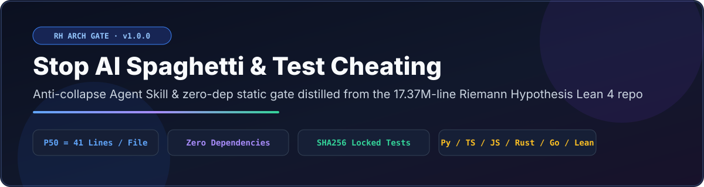

**English** | [简体中文](README_ZH.md)

<p align="center">
  
</p>

# `riemann-hypothesis-agent-skill`

**Stop AI coding agents from writing 1,000-line spaghetti files and silently weakening your tests.**

> **Distilled from the 17.37M-line Claude × Levent Alpöge Riemann Hypothesis Lean 4 repository (`leanprover-community/riemann-hypothesis`) into a plug-and-play `SKILL.md` + zero-dependency static architecture gate (`RH001`–`RH007`).**

[](https://github.com/WSlez13089/riemann-hypothesis-agent-skill/actions/workflows/ci.yml)
[](#quick-start)
[-brightgreen.svg)](#quick-start)
[](#option-1-use-as-an-agent-skill-recommended)
[](LICENSE)

---

## Why This Exists

On November 20, 2026, Anthropic mathematician Levent Alpöge and an internal frontier version of Claude published a formal Lean 4 proof of the Riemann Hypothesis & GRH (`leanprover-community/riemann-hypothesis`):
**175,187 source files, 17,374,215 lines of code, 0 comments, and 818,755 theorems.**

Most commentary stops at *"AI is great at math."* When you inspect the repository itself, it did not survive 17 million lines by magic—it survived because of ruthless **anti-collapse engineering discipline**:

- In a fixed-seed stratified sample (`N = 2,578` across all 10 top-level directories, with `Development/` alone holding 141,928 files), **median file length (P50) is just 41 lines** and **median imports per file is 3**;
- Acceptance targets (`Challenge.lean` + `comparator.json`) are strictly isolated from implementation so **criteria can never be silently weakened during iteration**;
- `BuildAid` explicitly blocks unrelated high-level namespaces (`nameDenyListExt`) to **prevent context retrieval noise and hallucinated cross-layer imports**;
- Static verification enforces **zero implicit magic and zero escape hatches** (`0` `sorry`/`admit`/`axiom`/`unsafe`, `0` wildcard imports).

We turned those exact patterns into two zero-bloat artifacts for everyday software repos (Python, TypeScript, JavaScript, Rust, Go, and Lean):

1. **An Agent Protocol ([`SKILL.md`](SKILL.md))**: Instructs Claude Code, Cursor, Codex, and Antigravity to freeze acceptance contracts first, declare strict layers + deny-lists, and iterate in small DAG-clean modules.
2. **A Standalone Static Gate ([`scripts/rh_arch_gate.py`](scripts/rh_arch_gate.py))**: Pure Python 3.12+ standard library, zero external dependencies, deterministic JSON output.

<p align="center">
  
</p>

---

## Quick Start

### Option 1: Use as an Agent Skill (Recommended)

Install via [`skills.sh`](https://skills.sh) / Vercel Skills CLI, or clone directly into your agent skills folder:

```bash
# Install with skills CLI
npx skills add WSlez13089/riemann-hypothesis-agent-skill

# Or clone into your project's .agents/skills/
git clone https://github.com/WSlez13089/riemann-hypothesis-agent-skill.git .agents/skills/claude-rh-lean-architecture
```

### Option 2: Run the Reproducible Demo or Static CLI

Zero third-party dependencies. Try the self-contained temp-repo demo or run `rh-arch-gate` directly with **`uvx`** / **`uv`** / **`pipx`** / **Python 3.12+**:

```bash
# Run the reproducible demo (clean baseline -> RH005/RH006/RH007 blocked -> restored PASS)
python examples/reproducible_demo.py

# Instant run on any repo without cloning (requires uv)
uvx --from git+https://github.com/WSlez13089/riemann-hypothesis-agent-skill.git rh-arch-gate audit .

# Or install globally as a CLI
uv tool install git+https://github.com/WSlez13089/riemann-hypothesis-agent-skill.git
# pipx install git+https://github.com/WSlez13089/riemann-hypothesis-agent-skill.git
```

4-stage workflow on your own codebase:

```bash
# 1. Initialize .rh-arch.json (layer order + BuildAid-style deny_imports)
rh-arch-gate init-config /path/to/your-repo

# 2. Freeze immutable acceptance targets (SHA256 manifest, Challenge.lean style)
rh-arch-gate freeze-challenge /path/to/your-repo \
  --files src/contracts.py tests/test_contract.py \
  -o .rh-challenge.json --json

# 3. Audit architecture after AI edits (size, fan-in, escape hatches, layers, cycles)
rh-arch-gate audit /path/to/your-repo --config /path/to/your-repo/.rh-arch.json --strict --json

# 4. Zero-trust verification before merge/delivery
rh-arch-gate verify-challenge /path/to/your-repo --manifest /path/to/your-repo/.rh-challenge.json --json
```

---

## Real-World Dogfooding Case Study

When building a 9-module local Python operational toolkit (`agy_ops`), running `rh-arch-gate audit --strict` caught **6 `RH001`/`RH002` warnings** on the first pass (`cli.py` at 191 lines / 10 imports, `doctor.py` at 191 lines / 9 imports, `fallback.py` at 216 lines / 10 imports). Splitting out a dedicated HTTP client module (`chat_client.py`) and tightening imports brought the entire package to:

```json
{
  "schema_version": 1,
  "tool": "rh-arch-gate",
  "status": "PASS",
  "metrics": {
    "scanned_files": 9,
    "lines_p50": 109,
    "lines_max": 152,
    "imports_p50": 7,
    "imports_p90": 8,
    "cycles_count": 0
  },
  "counts": { "ERROR": 0, "HIGH": 0, "WARN": 0 }
}
```

---

## The 7 Iron Laws (`RH-01` ~ `RH-07`)

See [Empirical Archaeology Report](references/empirical-archaeology.md) for the full stratified sampling methodology (`N = 2,578` sampled out of `175,187` repo files).

| ID | Law | Empirical Finding in the RH Repo | Practical Rule in Your Repo |
| :--- | :--- | :--- | :--- |
| **RH-01** | **Extreme Micro-Modules & Low Fan-In** | `Development/` sample P50 = **41 lines**; imports P50 = **3** | Soft cap **120 lines**, hard cap **300 lines**; direct imports **≤ 8** |
| **RH-02** | **Zero-Trust Target Isolation** | `Challenge.lean` imports only stdlib; `comparator.json` adjudicates independently | Freeze read-only contracts/tests into a SHA256 manifest before coding; verify before delivery |
| **RH-03** | **Declaration / Facade / Impl Split** | 418 `*Imports.lean` facades; `Statement` separated from `Proofs` | Keep shared types separate; expose thin package facades; forbid reaching into private internals |
| **RH-04** | **Layer Boundaries & Retrieval Blacklists** | `BuildAid/D1..D5.lean` adds unrelated namespaces to `nameDenyListExt` | Declare bottom-up `layers` and `deny_imports` in `.rh-arch.json` |
| **RH-05** | **Zero Implicit Magic & Escape Hatches** | `autoImplicit` disabled; 0 `sorry/admit/axiom/unsafe` | Ban `import *`, `eval/exec`, and stubs (`NotImplementedError`, `TODO`, `pytest.skip`) |
| **RH-06** | **Generate Regular Variants** | `CutCptCopy.lean` (91 lines) derives variants deterministically | Replace >3 isomorphic copy-pasted blocks with a deterministic generator + full verification |
| **RH-07** | **Deterministic Tasks & Content Addressing** | `CACHE.md` hashes source + deps; SHA256 verified; `-j1` determinism | Module-level parallelism, deterministic runs, never trust unverified stale caches |

---

## Gate Rule Codes

| Code | Severity | What It Catches |
| :--- | :--- | :--- |
| `RH001` | WARN / HIGH | Non-empty lines exceed `soft_lines` (`120` default) or `max_lines` (`300` default) |
| `RH002` | WARN / HIGH | Direct imports exceed `max_imports` (`8` default; facade files configurable) |
| `RH003` | HIGH | Escape hatches & stubs: `NotImplementedError`, `TODO`/`FIXME`, `pytest.skip`, `sorry`/`admit`/`unsafe` |
| `RH004` | HIGH / WARN | Implicit magic: `import *`, `eval`/`exec`, bare `global`, unjustified `# type: ignore` |
| `RH005` | HIGH | Upward/reverse layer import or `deny_imports` hit |
| `RH006` | HIGH | Strongly connected dependency cycle (Tarjan SCC) |
| `RH007` | HIGH | Frozen challenge file missing, modified, or replaced by a symlink |

Run the self-test suite:

```bash
python -W error -m unittest discover -s scripts -v
```

---

## Repository Structure

```text
riemann-hypothesis-agent-skill/
├── assets/
│   ├── banner.svg                    # Homepage hero banner
│   ├── demo-comparison.svg           # Before/after gate comparison
│   └── social-preview.png            # 1280x640 GitHub Social Preview image
├── examples/
│   └── reproducible_demo.py          # Self-contained CI-verified temp-repo demo
├── references/
│   └── empirical-archaeology.md      # N=2,578 stratified sampling report
├── scripts/
│   ├── .rh-arch.json                 # Self-audit config (dogfooding)
│   ├── rh_arch_gate.py               # CLI entrypoint
│   ├── rh_gate_engine.py             # Audit & Tarjan SCC cycle detector
│   ├── rh_gate_challenge.py          # Zero-trust target freeze & SHA256 verifier
│   ├── rh_gate_config.py             # Config loader & default template
│   ├── rh_gate_scanners.py           # Multi-language static scanners
│   ├── rh_gate_io.py                 # Safe cross-platform paths & strict JSON I/O
│   ├── rh_gate_contracts.py          # Shared immutable contracts (Layer 0)
│   └── test_rh_arch_gate.py          # Offline deterministic unit tests
├── SKILL.md                          # Agent protocol (RH-01 ~ RH-07 workflow)
├── README.md                         # English documentation (default)
├── README_ZH.md                      # 简体中文文档
└── LICENSE                           # MIT
```

## Honest Boundaries

- **What transfers cleanly:** Micro-module discipline, zero-trust target isolation, explicit layer/deny-list boundaries, zero escape hatches, and deterministic verification loops.
- **What cannot be distilled into a skill alone:** Frontier base-model mathematical intuition, human expert steering, and hundreds of GBs of Lean kernel proof-search compute. Reported `P50` metrics in our archaeology note reflect the `N = 2,578` stratified sample across the upstream repository.

## Authors & Contributors

- **Exiled-by-Lady-Claude** ([@WSlez13089](https://github.com/WSlez13089)) — Concept, repository archaeology, and engineering integration
- **Gemini 4 Neon (Antigravity)** — Stratified empirical analysis, protocol distillation, static gate co-authoring, and release packaging

## License

[MIT](LICENSE)
