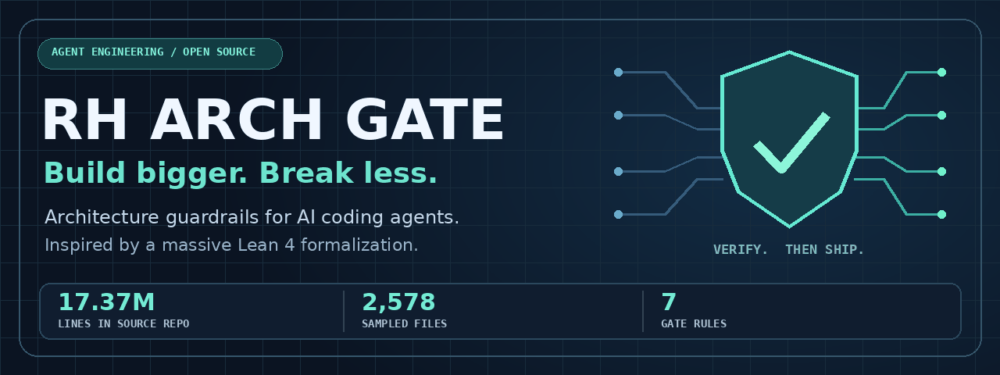
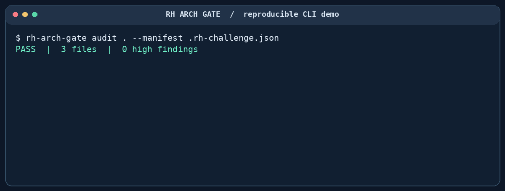
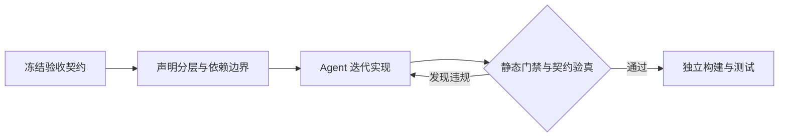

<p align="center">
  
</p>

# RH Arch Gate · 智能体架构门禁

[English](README.md) | **简体中文**

**让 AI 编程智能体的架构纪律从文字指令变成可执行检查。** 从 1737 万行 Lean 4 形式化工程汲取灵感，提供 [Agent Skill](SKILL.md) 与零运行时第三方依赖的静态门禁 CLI，检测架构退化、循环依赖、未完成实现以及冻结验收契约的异常变更。

[](https://github.com/WSlez13089/riemann-hypothesis-agent-skill/actions/workflows/ci.yml)
[](https://github.com/WSlez13089/riemann-hypothesis-agent-skill/releases)
[](#快速开始)
[](#快速开始)
[](LICENSE)

## 真实门禁演示



演示使用小型 Python 仓库中的刻意构造的错误，展示真实 CLI 运行结果的摘要。它不是 Agent 效能基准。克隆后通过 Python 3.12+ 复现：

```bash
python examples/quick_demo.py
```

脚本在独立临时目录中构造正常基线、注入问题、验证拦截并恢复基线；不会修改你的实际项目。

## 快速开始

### 作为 Agent Skill

```bash
npx skills add WSlez13089/riemann-hypothesis-agent-skill
```

适用于支持 SKILL.md 的编程助手，具体安装路径请遵循各工具说明。阅读 [Skill 协议](SKILL.md)。挂载 Skill 并不等于自动强制执行规则，还需要 Agent 或 CI 实际调用门禁。

### 作为独立 CLI

```bash
uvx --from git+https://github.com/WSlez13089/riemann-hypothesis-agent-skill.git@v1.0.0 rh-arch-gate audit .
```

或者克隆后直接运行（Python 3.12+）：

```bash
python scripts/rh_arch_gate.py audit . --json
```

初次审计仅静态读取，不导入或执行目标代码。建议先阅读扫描报告，再根据项目情况配置阈值，最后决定 CI 中哪些问题应阻断。

```bash
uv tool install git+https://github.com/WSlez13089/riemann-hypothesis-agent-skill.git@v1.0.0
rh-arch-gate init-config .
# 示例路径，请替换为真实的契约和验收测试
rh-arch-gate freeze-challenge . --files src/contracts.py tests/test_contract.py -o .rh-challenge.json
rh-arch-gate audit . --manifest .rh-challenge.json --json
rh-arch-gate verify-challenge . --manifest .rh-challenge.json --json
```

若需要防篡改，应将可信哈希清单、规则配置和最终门禁放在 Agent 无权修改的独立环境。SHA256 校验不等于访问控制。

## 核心架构



| 门禁 | 检查内容 |
| --- | --- |
| RH001 | 单文件非空行数上限（默认超过120警告，超过300高危） |
| RH002 | 单文件直接导入数（默认8个，识别出的门面文件豁免） |
| RH003 | 部分占位实现、逃生舱、跳过测试 |
| RH004 | 部分通配符导入、动态执行、隐式耦合 |
| RH005 | 分层越界或命中禁止导入规则 |
| RH006 | 多模块循环依赖（Tarjan SCC） |
| RH007 | 冻结契约相对于给定清单的缺失或改动 |

Python 采用 AST；Lean、TS/JS、Rust、Go 使用轻量词法扫描。无需安装 Skill 即可独立调用 CLI。

## 实证来源与迁移思路

项目基于 2026-11-25 的 [Lean 社区黎曼猜想形式化工程](https://github.com/leanprover-community/riemann-hypothesis) 快照开展研究。固定随机种子 20261125，对10个顶层分层共抽样2,578个文件。完整记录见 [实证考古报告](references/empirical-archaeology.md)。

| 原始工程中观察到的现象 | 报告数值 |
| --- | ---: |
| 原提交总行数 | 17,374,215 |
| 抽样文件数 | 2,578 |
| Development/ 主体文件总体规模 | 141,928 |
| 主体抽样文件行数中位数 | 41 |
| 合并样本直接导入数中位数 | 3 |
| Imports.lean 门面文件 | 418（报告中的全库统计） |

分层限额抽样的合并分位数不等同于总体分位数；这些是观察所得的工程规律，并非因果结论。

| 源工程模式 | Agent 工程映射 |
| --- | --- |
| 微模块与有限直接导入 | 可配置体积与导入预算 |
| 目标规格与实现分离 | 独立验收与可信清单 |
| 声明/门面/实现分离 | 显式接口与模块边界 |
| BuildAid 建议黑名单 | 导入黑名单，并非实际检索过滤器 |
| 实现的严格证明检查 | 识别部分未完成与动态执行结构 |
| 规律变体自动生成 | 确定性脚本替代重复复制 |
| 内容寻址与缓存验真 | 独立验证构建产物 |

120/300行、8个导入是**可配置的起始策略**，不是通用最佳阈值。Skill 中的全部建议并非都由当前门禁自动执行。

## 诚实边界

- 独立工程研究工具，不是黎曼猜想证明，也不是 Anthropic 或 Lean 官方项目。
- 上游 Challenge.lean 有意使用 sorry 声明验收目标，Comparator 独立核对实现；二者不能混淆。
- 静态扫描存在误报与漏报，应配合编译、类型检查、单测、安全审计。
- 本地哈希清单不是防篡改系统，需保护可信基线及验证环境。
- 尚未建立使用本 Skill 后成功率、Token 消耗和长期维护性的因果改善证据。
- 报告记录了抽样日期和随机种子，未记录准确抽样提交。上游标注 [40e56bab](https://github.com/leanprover-community/riemann-hypothesis/commit/40e56bab) 为原始提交，仅作溯源参考，不声称是确切抽样版本；原提交没有授权许可，本项目 MIT 仅覆盖本项目原创贡献。

## 开发与贡献

```bash
python -W error -m unittest discover -s scripts -v
python scripts/rh_arch_gate.py audit scripts --config .rh-arch.json --strict --json
python examples/quick_demo.py
```

欢迎提交可复现的误报、漏报、跨平台问题及 Agent 对照实验。更多内容见 [Skill 协议](SKILL.md)、[实证报告](references/empirical-archaeology.md)、[版本发布](https://github.com/WSlez13089/riemann-hypothesis-agent-skill/releases)。

## Authors & Contributors

- **Exiled-by-Lady-Claude** ([@WSlez13089](https://github.com/WSlez13089)) — 发起构思、仓库考古提炼与工程化集成
- **Gemini 4 Neon (Antigravity)** — 实证抽样分析、协议梳理、静态门禁联合编写与开源化打包

[MIT License](LICENSE)
