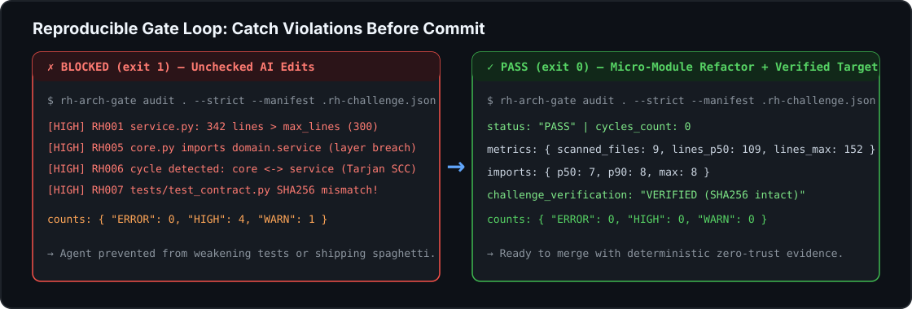

[English](README.md) | **简体中文**

<p align="center">
  
</p>

# `riemann-hypothesis-agent-skill`

**别再让 AI 把代码写成 1000 行大泥球，或在迭代中偷偷删改你的单元测试。**

> **把 1737 万行黎曼猜想 Lean 4 证明仓库（`leanprover-community/riemann-hypothesis`）的“不塌方工程骨架”，蒸馏成任何 AI Coding Agent 都能直接挂载的 `SKILL.md` + 零依赖静态门禁（`RH001`–`RH007`）。**

[](https://github.com/WSlez13089/riemann-hypothesis-agent-skill/actions/workflows/ci.yml)
[](#快速开始)
[-brightgreen.svg)](#快速开始)
[](#方式一作为-agent-skill-使用推荐)
[](LICENSE)

---

## 为什么做这个项目？

2026 年 11 月 20 日，Anthropic 数学家 Levent Alpöge 与内部版 Claude 公开了黎曼猜想 / GRH 的 Lean 4 形式化证明仓库（`leanprover-community/riemann-hypothesis`）：
**`175,187` 个源文件、`17,374,215` 行代码、0 行注释、`818,755` 条定理**。

大多数人看到这个新闻只会感叹“AI 数学好强”，但做过微观代码考古后会发现，它能写到 1700 万行还不散架，靠的是一套极其冷酷的**工程防塌方纪律**：
- 在针对全库 10 个顶层目录的分层抽样中（`N = 2,578`；其中核心证明目录 `Development/` 共 141,928 个文件），**单文件中位数（P50）只有 41 行**，单文件 `import` **P50 只有 3 个**；
- 验收靶子（`Challenge.lean` + `comparator.json`）与实现彻底物理隔离，**绝不允许在迭代中偷偷降标准**；
- 主动用 `BuildAid` 黑名单屏蔽无关高层命名空间，**防止上下文检索污染引发 Agent 幻觉引用**；
- 静态门禁把隐式魔法与逃生舱（`sorry`/`admit`、`import *`、占位桩）**全部归零**。

我们把这套可迁移骨架蒸馏成了两样东西（支持 Python / TypeScript / JavaScript / Rust / Go / Lean）：
1. **一本给 AI 看的行动铁律**（[`SKILL.md`](SKILL.md)）：引导 Claude Code / Cursor / Codex / Antigravity 先锁靶子、再分层、只写低耦合微模块；
2. **一把人类与 CI 都能跑的静态门禁**（[`scripts/rh_arch_gate.py`](scripts/rh_arch_gate.py)）：纯 Python 3.12+ 标准库、零第三方依赖。

<p align="center">
  
</p>

---

## 快速开始

### 方式一：作为 Agent Skill 使用（推荐）

```bash
# 使用 skills CLI 一键安装
npx skills add WSlez13089/riemann-hypothesis-agent-skill

# 或手动克隆到项目本地 .agents/skills/
git clone https://github.com/WSlez13089/riemann-hypothesis-agent-skill.git .agents/skills/claude-rh-lean-architecture
```

### 方式二：运行可复现 Demo 或独立 CLI 门禁

```bash
# 运行免配置临时仓库 Demo（洁净基线 PASS -> 注入 RH005/RH006/RH007 阻断 -> 恢复基线 PASS）
python examples/reproducible_demo.py

# 免克隆一行直接跑（需安装 uv）
uvx --from git+https://github.com/WSlez13089/riemann-hypothesis-agent-skill.git rh-arch-gate audit .

# 或全局安装为本地命令
uv tool install git+https://github.com/WSlez13089/riemann-hypothesis-agent-skill.git
# pipx install git+https://github.com/WSlez13089/riemann-hypothesis-agent-skill.git
```

标准四步工作流：

```bash
# 1. 生成 .rh-arch.json（分层规则 + BuildAid 风格引用黑名单）
rh-arch-gate init-config /path/to/your-repo

# 2. 编码前冻结“不可变验收靶子”（把核心契约/测试锁进 SHA256 清单）
rh-arch-gate freeze-challenge /path/to/your-repo \
  --files src/contracts.py tests/test_contract.py \
  -o .rh-challenge.json --json

# 3. 每次改完代码跑严格门禁
rh-arch-gate audit /path/to/your-repo --config /path/to/your-repo/.rh-arch.json --strict --json

# 4. 交付前零信任验真
rh-arch-gate verify-challenge /path/to/your-repo --manifest /path/to/your-repo/.rh-challenge.json --json
```

---

## 实战落地案例（Dogfooding）

在一个 9 模块的本地 Python 运维工具集（`agy_ops`）中，第一遍运行 `rh-arch-gate audit --strict` 立刻拦截出 **6 个 `RH001`/`RH002` 告警**（入口和路由文件超过 160 行且导入数 > 8）。按门禁提示将 HTTP 客户端拆入 `chat_client.py` 并收口导入后，全包指标降至：
- **9 个源码文件**，`lines_p50 = 109`、`lines_max = 152`、`imports_p50 = 7`、`cycles_count = 0`，`ERROR: 0 / HIGH: 0 / WARN: 0`（`PASS`）。

---

## 核心内容：七大工程铁律（`RH-01` ~ `RH-07`）

抽样细节见 [实证考古报告](references/empirical-archaeology.md)。

| 编号 | 铁律 | 黎曼仓库实证发现 | 落地到你的项目里是什么 |
| :--- | :--- | :--- | :--- |
| **RH-01** | **极端微模块与低扇入** | `Development/` 抽样 P50 仅 **41 行**；`import` P50 仅 **3 个** | 单文件软上限 **120 行**、硬上限 **300 行**；直接导入 **≤ 8** |
| **RH-02** | **零信任靶子隔离** | `Challenge.lean` 仅依赖标准库锁死契约，`comparator.json` 独立裁决 | 编码前冻结只读接口/测试并生成 SHA256 清单，交付前独立验真 |
| **RH-03** | **声明 / 门面 / 实现分离** | 全库 418 个 `*Imports.lean` 门面，`Statement` 与 `Proofs` 分离 | 公共类型单独成文件，子包只暴露薄门面，禁止跨包直插私有细节 |
| **RH-04** | **分层边界与检索黑名单** | `BuildAid/D1..D5.lean` 主动把无关高层命名空间写入 `nameDenyListExt` | 在 `.rh-arch.json` 显式声明层序 `layers` 与 `deny_imports` 黑名单 |
| **RH-05** | **零隐式魔法与零逃生舱** | 禁用 `autoImplicit`，静态扫描 0 `sorry/admit/axiom/unsafe` | 禁用 `import *`、`eval/exec`、占位桩（`NotImplementedError`/`TODO`/`pytest.skip`） |
| **RH-06** | **规律变体改用生成器** | `CutCptCopy.lean`（91 行）自动派生变体声明 | 超过 3 处同构样板代码改用确定性生成脚本 + 全量校验 |
| **RH-07** | **确定性单任务与内容寻址** | `CACHE.md` 按源码+依赖哈希缓存、SHA256 逐件验真、子作业 `-j1` | 模块级并行、单任务确定性执行，不轻信过期缓存 |

---

## 门禁规则速查

| 规则码 | 级别 | 拦什么问题 |
| :--- | :--- | :--- |
| `RH001` | WARN / HIGH | 单文件非空行数超过 `soft_lines`（默认 `120`）或 `max_lines`（默认 `300`） |
| `RH002` | WARN / HIGH | 单文件直接导入超过 `max_imports`（默认 `8`） |
| `RH003` | HIGH | 逃生舱与未完成桩：`NotImplementedError`、`TODO`/`FIXME`、`pytest.skip`、`sorry`/`admit`/`unsafe` |
| `RH004` | HIGH / WARN | 隐式魔法：`import *`、`eval`/`exec`、裸 `global`、无理由 `# type: ignore` |
| `RH005` | HIGH | 逆向跨层依赖或命中 `deny_imports` 黑名单 |
| `RH006` | HIGH | 模块间存在强连通循环依赖（Tarjan SCC 检测） |
| `RH007` | HIGH | 冻结靶子缺失、哈希被篡改或被替换为符号链接 |

运行门禁单元测试：

```bash
python -W error -m unittest discover -s scripts -v
```

---

## 诚实边界

- **能复现的**：微模块粒度纪律、零信任靶子隔离、分层与屏蔽边界、零逃生舱门禁、确定性验证闭环。
- **无法仅靠 Skill 复现的**：前沿基座模型本身的数学直觉、人类专家的方向纠偏，以及数百 GB 内存下由编译器内核驱动的高并发试错搜索算力。本文档中提及的 P50 分布数值来自对原仓库的固定种子分层抽样（`N = 2,578`）。

## Authors & Contributors

- **Exiled-by-Lady-Claude** ([@WSlez13089](https://github.com/WSlez13089)) — 发起构思、仓库考古提炼与工程化集成
- **Gemini 4 Neon (Antigravity)** — 实证抽样分析、协议梳理、静态门禁联合编写与开源化打包

## License

[MIT](LICENSE)
